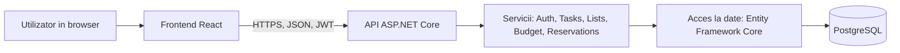

# Arhitectura aplicatiei

TaskNest are trei parti: aplicatia React din browser, un API REST in ASP.NET Core si o baza de date PostgreSQL.

## Diagrama



## Componente

| Componenta | Ce face |
|------------|---------|
| Frontend React | Paginile, formularele, validarea din browser si apelurile catre API |
| Controllere | Primesc cererile HTTP, verifica autentificarea si intorc JSON |
| Servicii | Logica aplicatiei: drepturile pe liste, calculul bugetului, verificarea suprapunerilor |
| Acces la date | Entity Framework Core cu migrari, face legatura intre obiecte si tabele |
| PostgreSQL | Stocheaza datele |

## Cum comunica

1. La autentificare, API-ul intoarce un token JWT.
2. React pastreaza tokenul si il trimite la fiecare cerere, in antetul `Authorization: Bearer <token>`.
3. API-ul verifica tokenul, afla despre ce utilizator e vorba si controleaza daca are voie la resursa ceruta (de exemplu, daca e membru al listei).
4. Serviciul face operatia prin Entity Framework Core, iar rezultatul se intoarce ca JSON.
5. Erorile folosesc coduri HTTP obisnuite: 400 date invalide, 401 neautentificat, 403 fara drept de acces, 404 inexistent, 409 conflict (de exemplu rezervare suprapusa).

## Structura repository-ului

```
frontend/   aplicatia React
backend/    solutia ASP.NET Core
docs/       documentatia
README.md
```

## Securitate

- Parolele se salveaza cu hash si salt (BCrypt sau PBKDF2).
- Toate endpoint-urile, in afara de inregistrare si login, cer token valid.
- Accesul la o lista se verifica pe server, nu doar in interfata.
- Datele primite se valideaza in backend, indiferent de ce verifica frontend-ul.
- CORS permite doar adresa aplicatiei frontend.
