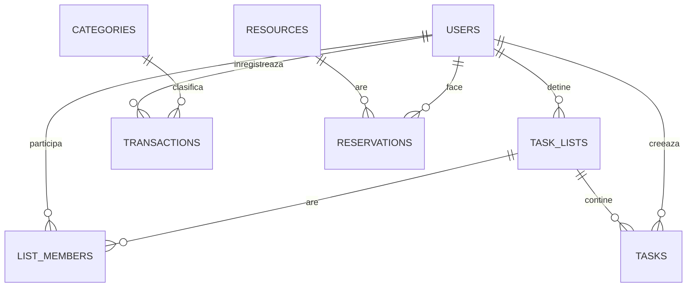

# Model de date si endpoint-uri

## Diagrama

## Entitati

- **USERS**: id (PK), name, email (unic), password_hash, role (User sau Admin), created_at
- **TASK_LISTS**: id (PK), name, owner_id (FK la USERS), created_at
- **LIST_MEMBERS**: list_id (FK la TASK_LISTS), user_id (FK la USERS), joined_at. Cheia primara e formata din cele doua id-uri.
- **TASKS**: id (PK), list_id (FK la TASK_LISTS), created_by (FK la USERS), title, description, due_date, is_done, created_at
- **CATEGORIES**: id (PK), name, user_id (FK la USERS, gol pentru categoriile implicite), monthly_limit (optional)
- **TRANSACTIONS**: id (PK), user_id (FK la USERS), category_id (FK la CATEGORIES), type (Income sau Expense), amount, date, note
- **RESOURCES**: id (PK), name, description, is_active
- **RESERVATIONS**: id (PK), resource_id (FK la RESOURCES), user_id (FK la USERS), start_time, end_time

## Relatii

- Un utilizator are mai multe liste, iar o lista are mai multi membri (many-to-many, prin LIST_MEMBERS).
- O lista contine mai multe sarcini.
- Un utilizator are mai multe tranzactii, fiecare cu o categorie.
- O resursa are mai multe rezervari, iar fiecare rezervare apartine unui utilizator.

## Constrangeri

- email-ul este unic
- amount trebuie sa fie mai mare ca 0
- end_time trebuie sa fie dupa start_time
- rezervarile aceleiasi resurse nu se pot suprapune (verificat in serviciu si, optional, printr-o constrangere de excludere in PostgreSQL)

## Endpoint-uri principale

| Metoda | Ruta | Ce face | Cine are acces |
|--------|------|---------|----------------|
| POST | `/api/auth/register` | Creeaza cont | Oricine |
| POST | `/api/auth/login` | Autentificare, intoarce JWT | Oricine |
| GET | `/api/lists` | Listele utilizatorului (proprii si partajate) | Autentificat |
| POST | `/api/lists` | Creeaza lista | Autentificat |
| PUT | `/api/lists/{id}` | Redenumeste lista | Proprietar |
| DELETE | `/api/lists/{id}` | Sterge lista | Proprietar |
| POST | `/api/lists/{id}/members` | Invita un membru dupa e-mail | Proprietar |
| DELETE | `/api/lists/{id}/members/{userId}` | Scoate un membru | Proprietar |
| GET | `/api/lists/{id}/tasks` | Sarcinile unei liste | Membru |
| POST | `/api/lists/{id}/tasks` | Adauga o sarcina | Membru |
| PUT | `/api/tasks/{id}` | Editeaza sau bifeaza o sarcina | Membru |
| DELETE | `/api/tasks/{id}` | Sterge o sarcina | Membru |
| GET | `/api/transactions?month=YYYY-MM` | Tranzactiile unei luni | Autentificat |
| POST | `/api/transactions` | Adauga o tranzactie | Autentificat |
| DELETE | `/api/transactions/{id}` | Sterge o tranzactie | Autentificat |
| GET | `/api/budget/summary?month=YYYY-MM` | Venituri, cheltuieli, disponibil, pe categorii | Autentificat |
| GET | `/api/resources` | Lista resurselor | Autentificat |
| POST | `/api/resources` | Adauga o resursa | Admin |
| GET | `/api/resources/{id}/reservations` | Rezervarile unei resurse | Autentificat |
| POST | `/api/reservations` | Creeaza rezervare (409 daca se suprapune) | Autentificat |
| DELETE | `/api/reservations/{id}` | Anuleaza rezervarea | Autorul sau Admin |
| GET | `/api/stats` | Statistici despre sarcini si cheltuieli | Autentificat |
